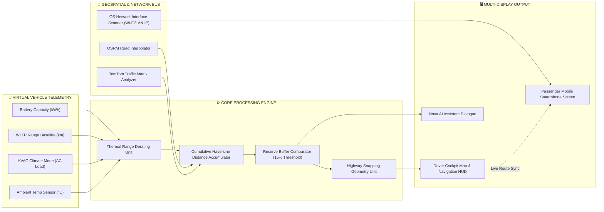
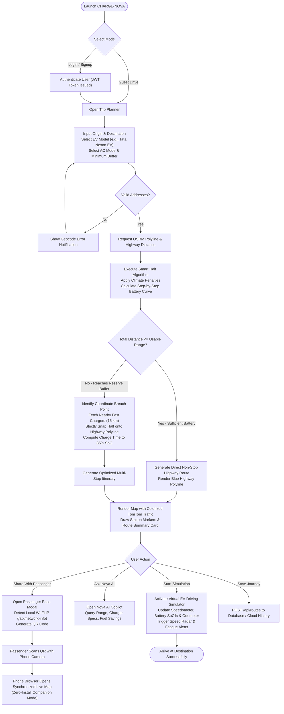
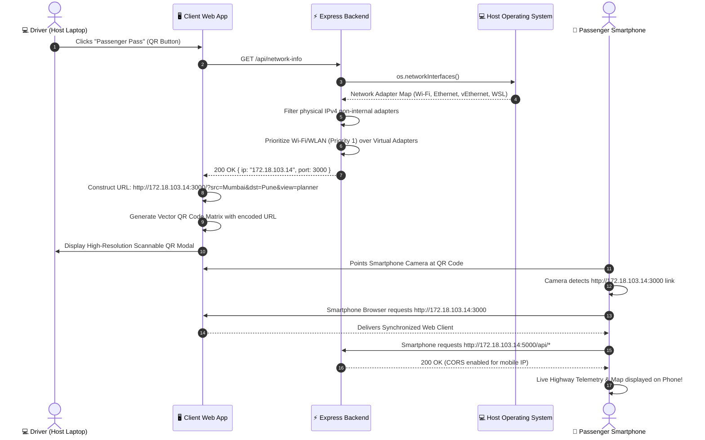
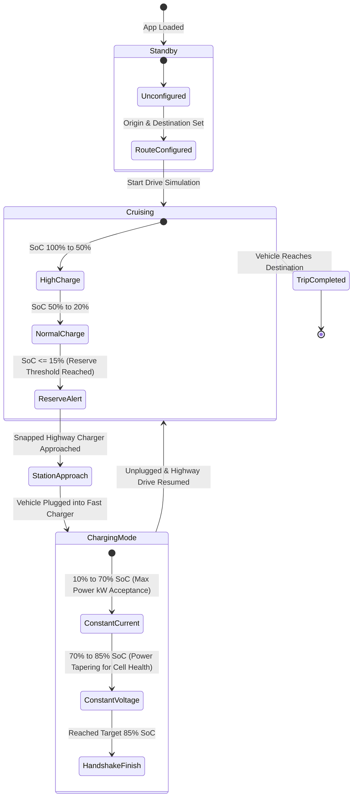
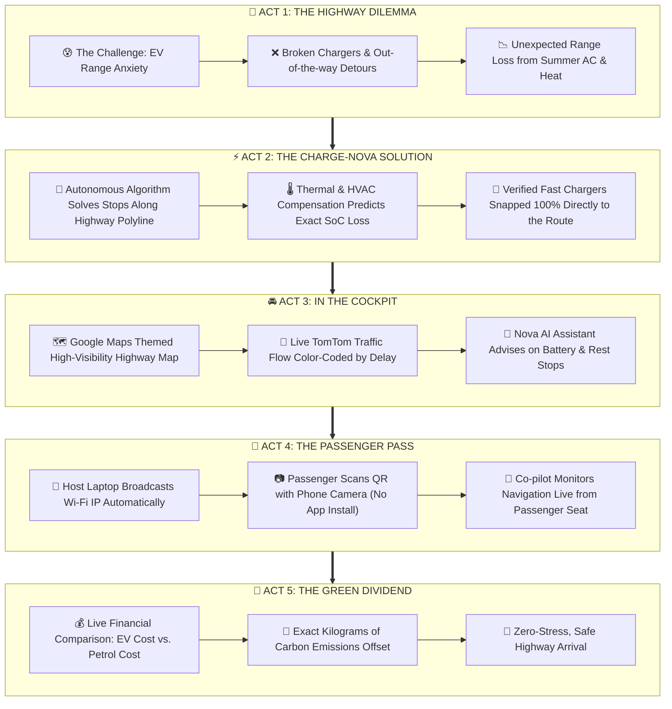

# ⚡ CHARGE-NOVA

> **Next-Generation Autonomous EV Highway Trip Planner, Smart Charging Halt Optimizer & Cross-Device Telemetry Companion.**

[](https://react.dev/)
[](https://nodejs.org/)
[](https://www.mongodb.com/)
[](https://leafletjs.com/)
[](https://maps.google.com/)
[](LICENSE)

---

## 📑 Table of Contents

1. [Executive Summary](#-executive-summary)
2. [Visual Architecture & System Diagrams](#-visual-architecture--system-diagrams)
   - [1. System Architecture Diagram](#1-system-architecture-diagram)
   - [2. Hardware & Software Block Diagram](#2-hardware--software-block-diagram)
   - [3. End-to-End User Flow Diagram](#3-end-to-end-user-flow-diagram)
   - [4. UML Class Diagram](#4-uml-class-diagram)
   - [5. Sequence Diagram: Trip Planning & Smart Halt Optimization](#5-sequence-diagram-trip-planning--smart-halt-optimization)
   - [6. Sequence Diagram: Mobile Passenger QR Sync](#6-sequence-diagram-mobile-passenger-qr-sync)
   - [7. EV Battery State Machine Diagram](#7-ev-battery-state-machine-diagram)
   - [8. Visual Product Story & Blog Walkthrough](#8-visual-product-story--blog-walkthrough)
3. [Key Highlights & Capabilities](#-key-highlights--capabilities)
4. [Algorithmic Models & Mathematics](#-algorithmic-models--mathematics)
5. [Technology Stack](#-technology-stack)
6. [Directory Structure](#-directory-structure)
7. [Installation & Setup](#-installation--setup)
8. [API Reference](#-api-reference)
9. [Future Roadmap & Next-Gen Implementations](#-future-roadmap--next-gen-implementations)
10. [Contributing & License](#-contributing--license)

---

## 📖 Executive Summary

**CHARGE-NOVA** is an enterprise-grade electric vehicle (EV) highway trip planning and telemetry simulation platform tailored for real-world driving conditions. Designed to eliminate range anxiety, CHARGE-NOVA dynamically computes mathematically optimal charging halts snapped strictly onto highway coordinates, models real-time battery State-of-Charge (SoC%) degradation factoring in HVAC load and ambient heat, renders live multi-tier TomTom traffic congestion, and enables seamless cross-device mobile companion pairing via local network QR discovery.

---

## 📐 Visual Architecture & System Diagrams

### 1. System Architecture Diagram
A comprehensive, multi-tiered enterprise architecture detailing the presentation layer, algorithmic core, networking gateway, persistence layer, and external microservices.

```mermaid
graph TB
    subgraph PresentationTier["📱 PRESENTATION LAYER (React 18 + Vite 5)"]
        UI_Shell["Google Maps Themed Shell & Responsive Layout"]
        Map_Canvas["Leaflet Interactive Geospatial Vector Canvas"]
        Input_Module["Route Input & Vehicle Selector Panel"]
        HUD_Telemetry["Live Driving HUD & Real-time Odometer"]
        QR_Modal["Passenger QR Companion Interface"]
        AI_Drawer["Nova AI Copilot Interaction Drawer"]
        Modals["Diagnostics (Battery Health, Cost Savings, SOS)"]
    end

    subgraph LogicTier["🧠 APPLICATION & ALGORITHMIC CORE"]
        Halt_Optimizer["Smart Halt Optimizer (Strict Polyline Snapping)"]
        Thermal_Model["HVAC & Ambient Temperature Penalty Engine"]
        Traffic_Engine["TomTom Traffic Road Segment Highlighter"]
        Sim_Loop["Real-Time EV Drive & Speed Simulation Loop"]
        AI_Engine["Contextual Telemetry AI Assistant Engine"]
    end

    subgraph GatewayTier["⚡ NETWORKING & GATEWAY LAYER (Node.js + Express)"]
        Server_Entry["Express Server (0.0.0.0:5000 Binding)"]
        CORS_Handler["Cross-Origin LAN Communication Policy"]
        Net_Resolver["Hardware Network Interface Resolver (os.networkInterfaces)"]
        Auth_MW["JWT Token Verification & Security Middleware"]
    end

    subgraph DataTier["💾 DATA PERSISTENCE & CACHING TIER"]
        Mongo_DB[("MongoDB Database (GeoJSON 2dsphere Spatial Index)")]
        In_Memory_Store[("Zero-Downtime In-Memory Fallback Cache")]
    end

    subgraph ExternalTier["🌐 EXTERNAL GEOSPATIAL & TELEMATICS SERVICES"]
        OSRM_API["OSRM Routing Engine (Polyline & Distance)"]
        Nominatim_API["OpenStreetMap Nominatim Geocoding API"]
        OCM_API["OpenChargeMap Global POI Database"]
        TomTom_API["TomTom Traffic Flow & Incidents API"]
        QR_API["QR Server API (Vector QR Matrix Engine)"]
    end

    %% Presentation to Logic
    Input_Module --> Halt_Optimizer
    Input_Module --> Thermal_Model
    Map_Canvas --> Traffic_Engine
    HUD_Telemetry --> Sim_Loop
    AI_Drawer --> AI_Engine

    %% Logic to External
    Halt_Optimizer --> OSRM_API
    Input_Module --> Nominatim_API
    Traffic_Engine --> TomTom_API
    QR_Modal --> QR_API

    %% Logic to Gateway
    Halt_Optimizer -.->|Spatial Station Query| Server_Entry
    QR_Modal -->|Fetch Host Wi-Fi IP| Net_Resolver
    UI_Shell -->|Auth & Route History| Server_Entry

    %% Gateway to Data
    Server_Entry --> Auth_MW
    Server_Entry --> Mongo_DB
    Server_Entry -.->|Auto Fallback if DB Down| In_Memory_Store
    Server_Entry -.->|Cache Miss Forward| OCM_API
```



---

### 2. Hardware & Software Block Diagram
Illustrates the dataflow between physical vehicle telemetry, software calculation engines, network interfaces, and passenger endpoints.



---

### 3. End-to-End User Flow Diagram
Detailed decision-tree walkthrough showing user interactions, branching logic, charging halt triggers, and mobile passenger handoff.



---

### 4. UML Class Diagram
A comprehensive structural diagram showcasing the domain models, services, algorithmic utilities, backend controllers, and client presentation components.

```mermaid
classDiagram
    %% Domain Models
    class User {
        +ObjectId _id
        +string name
        +string email
        +string password
        +string defaultVehicle
        +Date createdAt
    }

    class Station {
        +ObjectId _id
        +number openChargeMapId
        +string title
        +string operator
        +string address
        +GeoJSON location
        +number powerKW
        +string[] connectionTypes
        +boolean isFastCharger
        +string status
        +Date lastUpdated
    }

    class RouteHistory {
        +ObjectId _id
        +ObjectId userId
        +string title
        +string sourceName
        +string destName
        +number[] sourceCoords
        +number[] destCoords
        +string vehicleName
        +number distanceKm
        +number durationMins
        +number stopsCount
        +number chargingCostINR
        +number savedCostINR
        +Date createdAt
    }

    %% Backend Controllers
    class AuthController {
        +registerUser(req, res)
        +loginUser(req, res)
        +getMe(req, res)
        -generateToken(id) string
    }

    class StationController {
        +getNearbyStations(req, res)
        -queryMongoCache(lat, lng, dist)
        -fallbackOpenChargeMap(lat, lng, dist)
    }

    class RouteController {
        +saveRoute(req, res)
        +getSavedRoutes(req, res)
    }

    %% Algorithmic Utilities
    class ChargingAlgorithm {
        +calculateSmartHalts(params) Promise~HaltResult~
        -calculateDistanceKm(lat1, lon1, lat2, lon2) number
        -computeClimatePenalty(acMode, temp) number
        -snapToPolyline(point, targetCoord) Coordinate
    }

    class CostSavingsMath {
        +calculateTripCostAndSavings(distanceKm, totalKwh) SavingsReport
    }

    class TrafficModel {
        +generateTrafficSegments(coordinates) TrafficResult
    }

    %% Frontend Services
    class OSRMService {
        +fetchRoute(startCoords, endCoords) Promise~RouteData~
    }

    class NominatimService {
        +searchAddress(query) Promise~Location[]~
    }

    class OpenChargeMapService {
        +fetchStationsNearPoint(lat, lng, distanceKm) Promise~Station[]~
    }

    class ApiConfig {
        +getApiBaseUrl() string
    }

    %% Frontend Components
    class AppController {
        -sourceLocation: Location
        -destLocation: Location
        -selectedVehicle: Vehicle
        -batterySoC: number
        -recommendedStops: Station[]
        +handleRouteCalculation()
        +startDriveSimulation()
        +openPassengerQr()
    }

    %% Relationships
    User "1" --> "0..*" RouteHistory : owns
    StationController ..> Station : queries
    RouteController ..> RouteHistory : manages
    AuthController ..> User : authenticates

    AppController ..> OSRMService : uses
    AppController ..> NominatimService : uses
    AppController ..> ChargingAlgorithm : computes stops
    AppController ..> CostSavingsMath : calculates savings
    AppController ..> TrafficModel : computes traffic
    ChargingAlgorithm ..> OpenChargeMapService : fetches POIs
    AppController ..> ApiConfig : resolves host
```



---

### 5. Sequence Diagram: Trip Planning & Smart Halt Optimization
Captures the chronological message exchange during route planning, spatial snapping, and charge profile generation.

```mermaid
sequenceDiagram
    autonumber
    actor Driver as 🚗 Driver
    participant Client as 🖥️ CHARGE-NOVA Client
    participant Nominatim as 📍 Nominatim Geocoder
    participant OSRM as 🗺️ OSRM Engine
    participant HaltOptimizer as ⚡ Charging Algorithm
    participant Backend as 🌐 Express Server
    participant Mongo as 🗄️ MongoDB Cache
    participant OCM as 🔌 OpenChargeMap API

    Driver->>Client: Input "Mumbai" to "Pune" & Select "Tata Nexon EV"
    Client->>Nominatim: GET /search?q=Mumbai & GET /search?q=Pune
    Nominatim-->>Client: [Lat, Lng] Coordinates for Source & Destination

    Client->>OSRM: GET /route/v1/driving/Mumbai_coords;Pune_coords
    OSRM-->>Client: Return Polyline Waypoints & Total Highway Distance (148 km)

    Client->>HaltOptimizer: calculateSmartHalts(Polyline, Vehicle, AC="Max AC", Temp=40°C)
    
    activate HaltOptimizer
    HaltOptimizer->>HaltOptimizer: Apply Climate Factor: 1.0 - 0.12 (AC) - 0.08 (Heat) = 0.80
    HaltOptimizer->>HaltOptimizer: Derate Effective Range: 312 km * 0.80 = 249.6 km
    
    loop Traversal along Highway Coordinates
        HaltOptimizer->>HaltOptimizer: Decrement remaining battery range by segment distance
        alt Battery SoC <= 15% Reserve Threshold
            HaltOptimizer->>Backend: GET /api/stations/nearby?lat=pt.lat&lng=pt.lng&distance=15
            Backend->>Mongo: Station.find($near: [lng, lat], $maxDistance: 15000)
            alt Cache Hit
                Mongo-->>Backend: Return Cached Station POI
            else Cache Miss
                Backend->>OCM: GET /v3/poi/?countrycode=IN&lat=pt.lat&lng=pt.lng
                OCM-->>Backend: Return Live Global Fast Chargers
                Backend-->>Mongo: Save stations to local MongoDB
            end
            Backend-->>HaltOptimizer: Return Selected Fast Charger
            HaltOptimizer->>HaltOptimizer: Snap Station strictly to Highway Lat/Lng
            HaltOptimizer->>HaltOptimizer: Calculate Charge Time to 85% SoC = (Energy / PowerKW) * 60 + 5m
            HaltOptimizer->>HaltOptimizer: Reset Remaining Range to 85% Baseline
        end
    end
    HaltOptimizer-->>Client: Return { recommendedStops, batteryProfile, totalChargeTimeMins }
    deactivate HaltOptimizer

    Client->>Driver: Render Route Polyline, Snapped Stations & Driving HUD
```

---

### 6. Sequence Diagram: Mobile Passenger QR Sync
Details how local hardware network interfaces are discovered and paired with mobile devices without third-party cloud brokers.



---

### 7. EV Battery State Machine Diagram
Formal UML statechart tracking the virtual vehicle's battery conditions, charging modes, and degradation transitions.



---

### 8. Visual Product Story & Blog Walkthrough
A storyboard tracing how CHARGE-NOVA transforms the EV long-distance travel experience.



---

## 🌟 Key Highlights & Capabilities

- 🚗 **Strict Highway Snapping**: Charging stops are snapped strictly onto the highway polyline coordinates, preventing misleading 20 km off-road navigation detours.
- 🔋 **Physics & Thermal Degradation Engine**: Factors in continuous air conditioning (`Normal AC` vs. `Max AC` -12% penalty) and ambient temperature (>38°C -8% penalty).
- 📱 **Zero-Install Passenger Pass**: Discovers local Wi-Fi IP (`/api/network-info`), generating a camera-scannable QR code for phones on the same Wi-Fi or hotspot.
- 🚦 **TomTom Multi-Tier Traffic Highlighter**: High-visibility color-coded road chunks:
  - 🔵 **Royal Blue**: Clear, free-flowing highway.
  - 🟡 **Amber Yellow**: Slow-moving traffic road.
  - 🔴 **Bright Red**: Heavy traffic congestion.
  - 🔻 **Deep Crimson**: Severe highway gridlock.
- 💰 **Real-Time Savings & Carbon Analytics**: Live comparison of EV charging costs (₹18/kWh) against petrol vehicles (₹102/L at 14 km/L).
- 🤖 **Nova AI Copilot**: Live telemetry-aware assistant answering range feasibility, charger power specs, and rest stop queries.
- 🛡️ **Zero-Downtime Resilience**: Backend automatically falls back to an in-memory database if MongoDB is not running locally.

---

## 🧮 Algorithmic Models & Mathematics

### 1. Climate & HVAC Degradation Model
$$\text{ClimateFactor} = 1.0 - \Delta_{\text{AC}} - \Delta_{\text{Temp}}$$

- If **HVAC Mode** = `Max AC`: $\Delta_{\text{AC}} = 0.12$ (12% range reduction)
- If **Ambient Temperature** > $38^\circ\text{C}$: $\Delta_{\text{Temp}} = 0.08$ (8% range reduction)
$$\text{EffectiveRange} = \text{WLTP Range} \times \text{ClimateFactor}$$

### 2. Smart Charging Stop Optimization
A charging halt is triggered when the estimated remaining range drops below the safety buffer:
$$\text{MinBufferKm} = \left(\frac{\text{MinSoCBuffer}\%}{100}\right) \times \text{EffectiveRange}$$

For every triggered stop, energy replenishment to reach the optimal $85\%$ SoC cutoff is:
$$\text{EnergyNeeded (kWh)} = \left(\frac{85 - \text{ArrivalSoC}\%}{100}\right) \times \text{BatteryCapacity (kWh)}$$
$$\text{ChargeTime (mins)} = \left(\frac{\text{EnergyNeeded (kWh)}}{\text{ChargerPower (kW)}} \times 60\right) + 5\text{ mins (Handshake Overhead)}$$

### 3. Economic & Carbon Savings Formula (India Baseline)
$$\text{EV Cost (₹)} = \left(\frac{\text{Distance}}{6.2\text{ km/kWh}}\right) \times 18\text{ ₹/kWh}$$
$$\text{Petrol Cost (₹)} = \left(\frac{\text{Distance}}{14\text{ km/L}}\right) \times 102\text{ ₹/L}$$
$$\text{Savings (₹)} = \text{Petrol Cost} - \text{EV Cost}$$
$$\text{Carbon Saved (kg CO}_2\text{)} = \text{Distance (km)} \times 0.135\text{ kg/km}$$

---

## 🛠️ Technology Stack

| Layer | Technology | Purpose |
|---|---|---|
| **Frontend Framework** | **React 18** + **Vite 5** | High-performance SPA with instant HMR and optimized bundling |
| **Styling & Theme** | **Vanilla CSS + TailwindCSS** | Google Maps Clean Light Theme with custom elevations and popups |
| **Mapping Engine** | **Leaflet** + **React-Leaflet** | Interactive geospatial canvas with polyline vector layers |
| **Icons & Typography** | **Lucide React** + **Plus Jakarta Sans** | Modern icon set and typography system |
| **Backend Runtime** | **Node.js** + **Express** | RESTful API server bound to `0.0.0.0` for LAN accessibility |
| **Database & Spatial** | **MongoDB** + **Mongoose** | GeoJSON spatial indexing (`2dsphere`) with in-memory fallback |
| **Security & Auth** | **JWT** + **bcryptjs** | Stateless authentication tokens and password hashing |
| **Routing & Geocoding** | **OSRM** + **Nominatim** | Open-source road routing, waypoint interpolation, and geocoding |
| **EV POI Data** | **OpenChargeMap API** | Global electric vehicle charging station registry |
| **Live Traffic** | **TomTom Traffic API** | Real-time congestion monitoring and corridor delays |

---

## 📂 Directory Structure

```text
CHARGE-NOVA/
├── .gitignore                      # Git exclusion rules (node_modules, dist, .env)
├── README.md                       # Comprehensive system documentation & architecture
│
├── client/                         # React 18 Frontend Application
│   ├── .env.example                # Sample environment variables for client
│   ├── package.json                # Frontend dependencies and build scripts
│   ├── vite.config.js              # Vite configuration
│   └── src/
│       ├── App.jsx                 # Master application controller and layout
│       ├── main.jsx                # Application root mount
│       ├── index.css               # Google Maps design tokens and global styles
│       ├── components/             # Reusable UI widgets and modals
│       │   ├── LandingPage.jsx     # Modern marketing & hero interface
│       │   ├── InputPanel.jsx      # Route planning input & vehicle selector
│       │   ├── MapToolbar.jsx      # Map layer controls (Traffic, Stations, Cameras)
│       │   ├── RouteSummary.jsx    # Trip distance, duration & charging stops card
│       │   ├── SimulatorControl.jsx# Virtual EV driving simulation controls
│       │   ├── PassengerQrModal.jsx# Mobile QR pairing & network selector
│       │   ├── NovaAiAssistant.jsx # AI assistant chat drawer
│       │   ├── CostSavingsWidget.jsx# EV vs. Petrol economics & carbon calculator
│       │   ├── BatteryHealthModal.jsx# Battery degradation & lifecycle metrics
│       │   ├── StationModal.jsx    # Detailed station inspector & slot reservation
│       │   ├── TrafficLegend.jsx   # Traffic color-coding status indicators
│       │   ├── SpeedAlert.jsx      # Highway speed limit compliance monitor
│       │   ├── FatigueAlert.jsx    # Continuous driving rest-stop reminder
│       │   ├── SosModal.jsx        # Roadside emergency dispatch modal
│       │   ├── AuthModal.jsx       # Login & signup dialog
│       │   └── AccountDashboardModal.jsx # User profile & saved trips library
│       ├── services/               # API clients & network adapters
│       │   ├── apiConfig.js        # Dynamic LAN/host IP resolver
│       │   ├── osrmService.js      # Polyline route generation
│       │   ├── nominatimService.js # City & address geocoding
│       │   ├── openChargeMapService.js # Live charging station queries
│       │   ├── liveTrafficService.js  # TomTom traffic flow queries
│       │   └── aiKnowledgeService.js  # Telemetry-aware AI query engine
│       └── utils/                  # Algorithmic models & mathematical utilities
│           ├── chargingAlgorithm.js # Strict polyline-snapped smart halt solver
│           ├── trafficModel.js     # Road chunking & congestion highlighter
│           ├── costSavingsMath.js  # Economic & ecological computation
│           ├── speedCameraService.js# Highway radar camera simulator
│           └── trafficSignals.js   # Junction signal timing simulator
│
└── server/                         # Express Backend Application
    ├── .env.example                # Sample environment variables for server
    ├── package.json                # Backend dependencies and scripts
    └── src/
        ├── server.js               # Entrypoint (0.0.0.0 listener & /api/network-info)
        ├── config/
        │   └── db.js               # MongoDB Mongoose connection manager
        ├── models/
        │   ├── User.js             # User account schema
        │   ├── Station.js          # GeoJSON EV station schema with 2dsphere index
        │   └── RouteHistory.js     # Saved trip history schema
        ├── controllers/
        │   ├── authController.js   # Authentication & JWT generation
        │   ├── stationController.js# Spatial station query & OCM cache
        │   └── routeController.js  # Trip saving & retrieval (with memory fallback)
        ├── routes/
        │   ├── authRoutes.js       # /api/auth routes
        │   ├── stationRoutes.js    # /api/stations routes
        │   └── routeRoutes.js      # /api/routes routes
        └── middleware/
            └── authMiddleware.js   # JWT verification middleware
```

---

## 🚀 Installation & Setup

### 1. Clone the Repository
```bash
git clone https://github.com/tanishbhagat1436/CHARGE-NOVA.git
cd CHARGE-NOVA
```

### 2. Configure Environment Files

**Backend (`server/.env`):**
```env
PORT=5000
MONGODB_URI=mongodb://localhost:27017/chargenova
JWT_SECRET=your_jwt_secret_here
OPENCHARGEMAP_API_KEY=your_openchargemap_api_key_here
CLIENT_URL=http://localhost:3000
```

**Frontend (`client/.env`):**
```env
VITE_TOMTOM_API_KEY=your_tomtom_api_key_here
VITE_OPENCHARGEMAP_API_KEY=your_openchargemap_api_key_here
```

### 3. Install Dependencies & Launch

```bash
# Terminal 1 - Backend
cd server
npm install
npm run dev

# Terminal 2 - Frontend
cd client
npm install
npm run dev -- --host
```

---

## 🔌 API Reference

| Method | Endpoint | Description |
|---|---|---|
| `GET` | `/api/network-info` | Discovers active LAN IP from `os.networkInterfaces()` for mobile QR pairing |
| `POST` | `/api/auth/register` | Registers a new driver profile with bcrypt password hashing |
| `POST` | `/api/auth/login` | Authenticates driver and returns 30-day JWT bearer token |
| `GET` | `/api/auth/me` | Retrieves current authenticated driver profile |
| `GET` | `/api/stations/nearby` | Queries MongoDB cache using `$near` 2dsphere index (with OCM fallback) |
| `POST` | `/api/routes` | Saves completed or planned highway trips to route history |
| `GET` | `/api/routes` | Fetches saved route history and total financial savings |

---

## 🔮 Future Roadmap & Next-Gen Implementations

- [ ] **Real-Time OCPP 2.0.1 Protocol Integration**: Direct cloud connectivity to CPOs (Tata Power EZ Charge, Zeon, Jio-bp, Statiq) for live plug availability and reservation.
- [ ] **Vehicle-to-Grid (V2G) Bi-Directional Energy Arbitrage**: Algorithms calculating financial returns when discharging stored EV energy back to the smart grid during peak tariff hours.
- [ ] **Digital Elevation Model (DEM) & Aero Drag Calculations**: Integration of topographic gradient data to simulate regenerative braking gain on descents and elevated consumption on steep climbs.
- [ ] **Offline Vector Tiles & PWA Cache**: Progressive Web App capabilities caching national highway corridors for zero-connectivity driving across remote passes.
- [ ] **Android Auto & Apple CarPlay Integration**: Native projection interface optimized for in-vehicle head units.
- [ ] **Fleet Convoy Routing**: Multi-EV synchronized highway routing ensuring fleet members avoid charger bottleneck contention.

---

## 📄 License

Distributed under the **MIT License**. See `LICENSE` for details.
