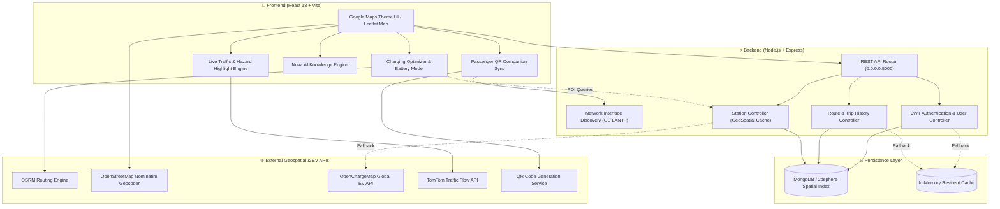
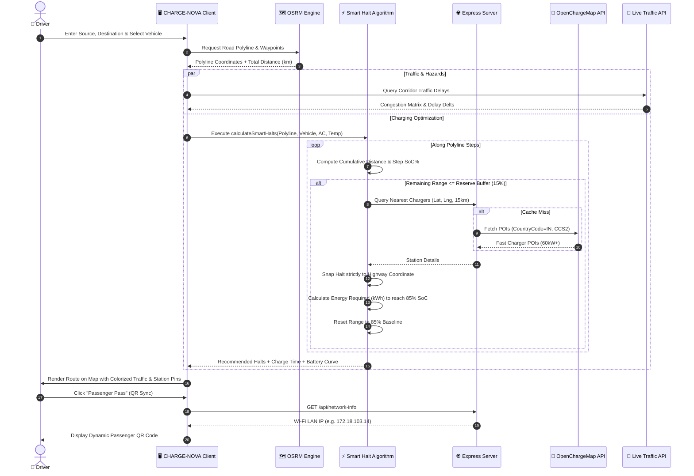
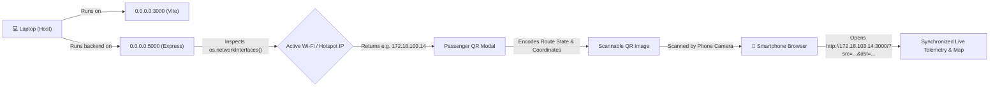
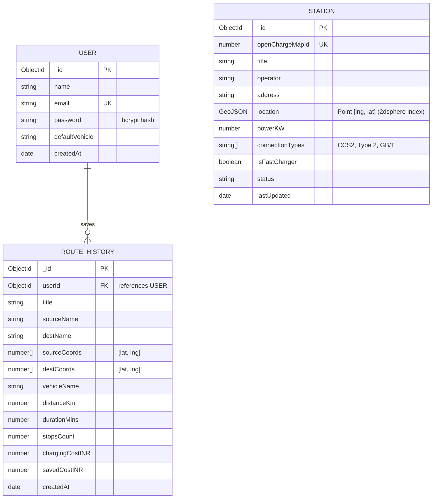
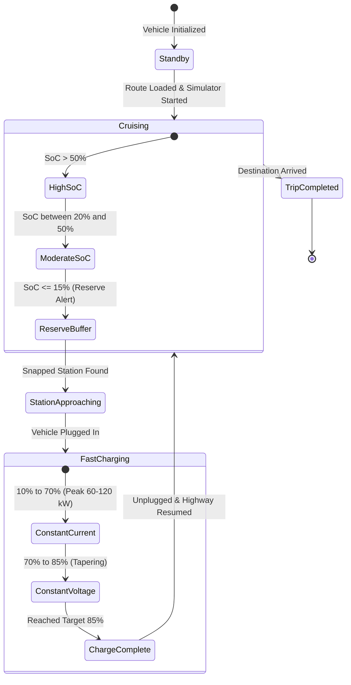

# ⚡ CHARGE-NOVA

> **Next-Generation Autonomous EV Highway Trip Planner, Smart Charging Halt Optimizer & Cross-Device Telemetry Companion.**

[](https://react.dev/)
[](https://nodejs.org/)
[](https://www.mongodb.com/)
[](https://leafletjs.com/)
[](https://maps.google.com/)
[](LICENSE)

---

## 📖 Executive Summary

**CHARGE-NOVA** is an intelligent, high-precision electric vehicle (EV) highway trip planning and telemetry simulation platform tailored for real-world driving. It eliminates range anxiety by dynamically calculating optimal charging halts snapped strictly along highway corridors, predicting battery State-of-Charge (SoC%) degradation based on climate/HVAC load and ambient temperature, overlaying real-time traffic congestion, and offering instant cross-device mobile companion pairing via local network QR discovery.

---

## 🌟 Key Highlights & Capabilities

- 🚗 **Autonomous Charging Halt Optimizer**: Automatically computes mathematically optimal charging stops along the exact OSRM highway polyline based on vehicle battery capacity, range, and reserve buffers.
- 🔋 **Physics & Climate-Aware Battery Model**: Factors in air conditioning overhead (`Normal AC` vs. `Max AC` -12% penalty) and extreme ambient heat (>38°C -8% penalty) to prevent sudden highway cutoffs.
- 📱 **Multi-Screen Passenger Companion Pass**: Uses local network interface discovery (`/api/network-info`) to generate an instant QR code. Passengers scan with their mobile camera to monitor live navigation and route stats in real-time.
- 🚦 **Live Traffic & Road Hazard Overlays**: Multi-tier TomTom color-coded congestion segments (Clear Blue, Slow Amber, Congested Red, Gridlock Crimson) plus speed camera and driver fatigue alerts (>2 hrs driving).
- 💰 **Financial & Carbon Offset Analytics**: Live comparison of EV charging costs (₹18/kWh) against internal combustion vehicles (Petrol ₹102/L at 14 km/L), calculating net INR saved and kilograms of CO₂ avoided.
- 🤖 **Nova AI Assistant**: Contextual AI copilot answering driver inquiries regarding route feasibility, nearest fast chargers (CCS2, GB/T, Type 2), fuel savings, and rest stops.
- 🛡️ **Zero-Downtime Resilience**: Backend automatically operates with local MongoDB or gracefully degrades to resilient in-memory stores if the database service is offline.

---

## 📐 System Architecture

CHARGE-NOVA utilizes a distributed, decoupled client-server architecture integrating live geospatial services, telemetry calculation modules, and hardware-network adapters.



---

## 🔄 Sequence Flow: Trip Planning & Smart Charging Execution

This sequence diagram illustrates the lifecycle of a user planning a highway journey from origin to destination.



---

## 📱 Mobile Passenger QR Synchronization Flow

CHARGE-NOVA features cross-device session pairing without requiring user cloud logins or app installations.



---

## 🗄️ Database Entity Relationship (ERD)

The MongoDB schema uses geospatial indexing (`2dsphere`) to perform fast corridor bounding box queries.



---

## 🔄 EV Battery State Machine & Simulation Lifecycle



---

## 🧮 Core Algorithms & Scientific Models

### 1. Climate & HVAC Degradation Model
Electric vehicle range is profoundly impacted by cabin thermal management and external battery pack temperature:
$$\text{ClimateFactor} = 1.0 - \Delta_{\text{AC}} - \Delta_{\text{Temp}}$$

- If **HVAC Mode** = `Max AC`: $\Delta_{\text{AC}} = 0.12$ (12% range reduction)
- If **Ambient Temperature** > $38^\circ\text{C}$: $\Delta_{\text{Temp}} = 0.08$ (8% range reduction)
$$\text{EffectiveRange} = \text{WLTP Range} \times \text{ClimateFactor}$$

### 2. Smart Charging Stop Optimization
A charging halt is triggered when the estimated remaining range drops below the safety buffer:
$$\text{MinBufferKm} = \left(\frac{\text{MinSoCBuffer}\%}{100}\right) \times \text{EffectiveRange}$$

For every triggered stop, the energy replenishment to reach the optimal $85\%$ SoC cutoff is:
$$\text{EnergyNeeded (kWh)} = \left(\frac{85 - \text{ArrivalSoC}\%}{100}\right) \times \text{BatteryCapacity (kWh)}$$
$$\text{ChargeTime (mins)} = \left(\frac{\text{EnergyNeeded (kWh)}}{\text{ChargerPower (kW)}} \times 60\right) + 5\text{ mins (Handshake Overhead)}$$

### 3. Economic & Ecological Savings Formula (India Baseline)
$$\text{EV Cost (₹)} = \left(\frac{\text{Distance}}{6.2\text{ km/kWh}}\right) \times 18\text{ ₹/kWh}$$
$$\text{Petrol Cost (₹)} = \left(\frac{\text{Distance}}{14\text{ km/L}}\right) \times 102\text{ ₹/L}$$
$$\text{Savings (₹)} = \text{Petrol Cost} - \text{EV Cost}$$
$$\text{Carbon Saved (kg CO}_2\text{)} = \text{Distance (km)} \times 0.135\text{ kg/km}$$

---

## 🛠️ Technology Stack

| Layer | Technology | Purpose |
|---|---|---|
| **Frontend Framework** | **React 18** + **Vite 5** | High-performance SPA with instant HMR and optimized production bundling |
| **Styling & Theme** | **Vanilla CSS + TailwindCSS** | Google Maps Clean Light Theme with custom elevations, pills, and popups |
| **Mapping Engine** | **Leaflet** + **React-Leaflet** | Interactive geospatial canvas with polyline vector layers & custom SVG markers |
| **Icons & Typography** | **Lucide React** + **Plus Jakarta Sans** | Modern icon set and typography system |
| **Backend Runtime** | **Node.js** + **Express** | RESTful API server bound to `0.0.0.0` for LAN accessibility |
| **Database & Spatial** | **MongoDB** + **Mongoose** | GeoJSON spatial indexing (`2dsphere`) with automated in-memory fallbacks |
| **Security & Auth** | **JWT** + **bcryptjs** | Stateless authentication tokens and password hashing |
| **Routing & Geocoding** | **OSRM** + **Nominatim** | Open-source road routing, waypoint interpolation, and geocoding |
| **EV POI Data** | **OpenChargeMap API** | Global electric vehicle charging station registry |
| **Live Traffic** | **TomTom Traffic API** | Real-time congestion monitoring and corridor delays |

---

## 📂 Project Structure

```text
CHARGE-NOVA/
├── .gitignore                      # Git exclusion rules (node_modules, dist, .env)
├── README.md                       # Comprehensive system documentation & architecture
│
├── client/                         # React 18 Frontend Application
│   ├── .env.example                # Sample environment variables for client
│   ├── package.json                # Frontend dependencies and build scripts
│   ├── vite.config.js              # Vite configuration
│   └── src/
│       ├── App.jsx                 # Master application controller and layout
│       ├── main.jsx                # Application root mount
│       ├── index.css               # Google Maps design tokens and global styles
│       ├── components/             # Reusable UI widgets and modals
│       │   ├── LandingPage.jsx     # Modern marketing & hero interface
│       │   ├── InputPanel.jsx      # Route planning input & vehicle selector
│       │   ├── MapToolbar.jsx      # Map layer controls (Traffic, Stations, Cameras)
│       │   ├── RouteSummary.jsx    # Trip distance, duration & charging stops card
│       │   ├── SimulatorControl.jsx# Virtual EV driving simulation controls
│       │   ├── PassengerQrModal.jsx# Mobile QR pairing & network selector
│       │   ├── NovaAiAssistant.jsx # AI assistant chat drawer
│       │   ├── CostSavingsWidget.jsx# EV vs. Petrol economics & carbon calculator
│       │   ├── BatteryHealthModal.jsx# Battery degradation & lifecycle metrics
│       │   ├── StationModal.jsx    # Detailed station inspector & slot reservation
│       │   ├── TrafficLegend.jsx   # Traffic color-coding status indicators
│       │   ├── SpeedAlert.jsx      # Highway speed limit compliance monitor
│       │   ├── FatigueAlert.jsx    # Continuous driving rest-stop reminder
│       │   ├── SosModal.jsx        # Roadside emergency dispatch modal
│       │   ├── AuthModal.jsx       # Login & signup dialog
│       │   └── AccountDashboardModal.jsx # User profile & saved trips library
│       ├── services/               # API clients & network adapters
│       │   ├── apiConfig.js        # Dynamic LAN/host IP resolver
│       │   ├── osrmService.js      # Polyline route generation
│       │   ├── nominatimService.js # City & address geocoding
│       │   ├── openChargeMapService.js # Live charging station queries
│       │   ├── liveTrafficService.js  # TomTom traffic flow queries
│       │   └── aiKnowledgeService.js  # Telemetry-aware AI query engine
│       └── utils/                  # Algorithmic models & mathematical utilities
│           ├── chargingAlgorithm.js # Strict polyline-snapped smart halt solver
│           ├── trafficModel.js     # Road chunking & congestion highlighter
│           ├── costSavingsMath.js  # Economic & ecological computation
│           ├── speedCameraService.js# Highway radar camera simulator
│           └── trafficSignals.js   # Junction signal timing simulator
│
└── server/                         # Express Backend Application
    ├── .env.example                # Sample environment variables for server
    ├── package.json                # Backend dependencies and scripts
    └── src/
        ├── server.js               # Entrypoint (0.0.0.0 listener & /api/network-info)
        ├── config/
        │   └── db.js               # MongoDB Mongoose connection manager
        ├── models/
        │   ├── User.js             # User account schema
        │   ├── Station.js          # GeoJSON EV station schema with 2dsphere index
        │   └── RouteHistory.js     # Saved trip history schema
        ├── controllers/
        │   ├── authController.js   # Authentication & JWT generation
        │   ├── stationController.js# Spatial station query & OCM cache
        │   └── routeController.js  # Trip saving & retrieval (with memory fallback)
        ├── routes/
        │   ├── authRoutes.js       # /api/auth routes
        │   ├── stationRoutes.js    # /api/stations routes
        │   └── routeRoutes.js      # /api/routes routes
        └── middleware/
            └── authMiddleware.js   # JWT verification middleware
```

---

## 🚀 Getting Started

### Prerequisites

- **Node.js**: v18.0.0 or higher
- **npm** or **yarn**
- **MongoDB** (Optional: the backend automatically runs in memory if MongoDB is not running locally)

---

### 1. Clone the Repository

```bash
git clone https://github.com/tanishbhagat1436/CHARGE-NOVA.git
cd CHARGE-NOVA
```

---

### 2. Configure Environment Variables

#### Backend Configuration (`server/.env`):
Create `server/.env` based on `server/.env.example`:
```env
PORT=5000
MONGODB_URI=mongodb://localhost:27017/chargenova
JWT_SECRET=your_jwt_secret_here
OPENCHARGEMAP_API_KEY=your_openchargemap_api_key_here
CLIENT_URL=http://localhost:3000
```

#### Frontend Configuration (`client/.env`):
Create `client/.env` based on `client/.env.example`:
```env
VITE_TOMTOM_API_KEY=your_tomtom_api_key_here
VITE_OPENCHARGEMAP_API_KEY=your_openchargemap_api_key_here
```

---

### 3. Install Dependencies

```bash
# Install Server Dependencies
cd server
npm install

# Install Client Dependencies
cd ../client
npm install
```

---

### 4. Run the Development Servers

#### Terminal 1 — Backend:
```bash
cd server
npm run dev
```
*Backend initializes on `http://0.0.0.0:5000` (allowing mobile LAN connections).*

#### Terminal 2 — Frontend:
```bash
cd client
npm run dev -- --host
```
*Frontend launches on `http://0.0.0.0:3000`.*

---

## 🔌 API Reference & Endpoints

### 1. Network & Telemetry Discovery
- `GET /api/network-info`
  - Returns active host network interfaces, prioritizing Wi-Fi over virtual adapters to allow instant mobile QR companion pairing.

### 2. Authentication
- `POST /api/auth/register` — Register a new account (`name`, `email`, `password`).
- `POST /api/auth/login` — Sign in and obtain a JWT bearer token.
- `GET /api/auth/me` — Retrieve the currently authenticated user profile.

### 3. Charging Stations
- `GET /api/stations/nearby?lat={lat}&lng={lng}&distance={km}`
  - Searches MongoDB for cached stations within radius using `$near` 2dsphere spatial geometry.
  - Automatically queries OpenChargeMap API for India on cache misses.

### 4. Route History
- `POST /api/routes` — Save a planned route (authenticated or guest session).
- `GET /api/routes` — Retrieve saved routes and savings analytics.

---

## 🔮 Future Roadmap & Next-Gen Implementations

- [ ] **Real-Time OCPP 2.0.1 Protocol Integration**: Direct cloud connection to charging point operators (Tata Power EZ Charge, Zeon, Jio-bp, Statiq) for live plug availability and automated queue reservation.
- [ ] **Vehicle-to-Grid (V2G) Bi-Directional Energy Arbitrage**: Algorithms calculating financial returns when discharging stored EV energy back to the smart grid during peak tariff hours.
- [ ] **Digital Elevation Model (DEM) & Aero Drag Calculations**: Integration of topographic gradient data to simulate regenerative braking gain on descents and elevated consumption on steep climbs.
- [ ] **Offline Vector Tiles & PWA Cache**: Progressive Web App capabilities caching national highway corridors for zero-connectivity driving across remote passes.
- [ ] **Android Auto & Apple CarPlay Integration**: Native projection interface optimized for in-vehicle head units.
- [ ] **Fleet Convoy Routing**: Multi-EV synchronized highway routing ensuring fleet members avoid charger bottleneck contention.

---

## 🤝 Contributing

Contributions are welcomed! Follow these steps:
1. **Fork** the repository.
2. Create a feature branch: `git checkout -b feature/amazing-feature`.
3. Commit your changes: `git commit -m "feat: add amazing feature"`.
4. Push to your branch: `git push origin feature/amazing-feature`.
5. Open a **Pull Request**.

---

## 📄 License

This project is licensed under the **MIT License**.
